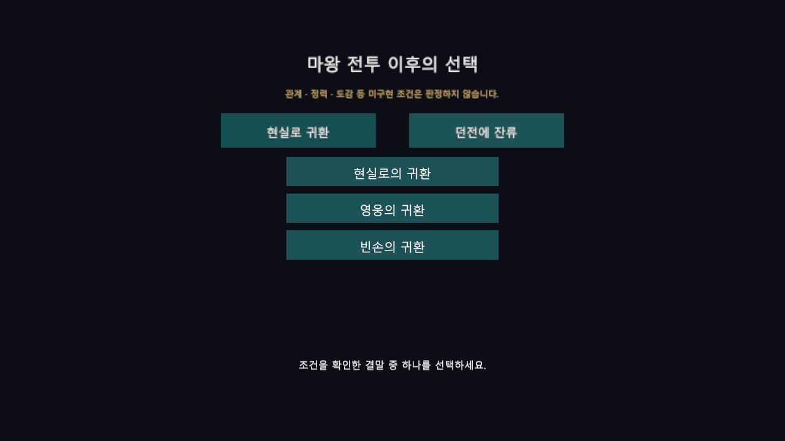
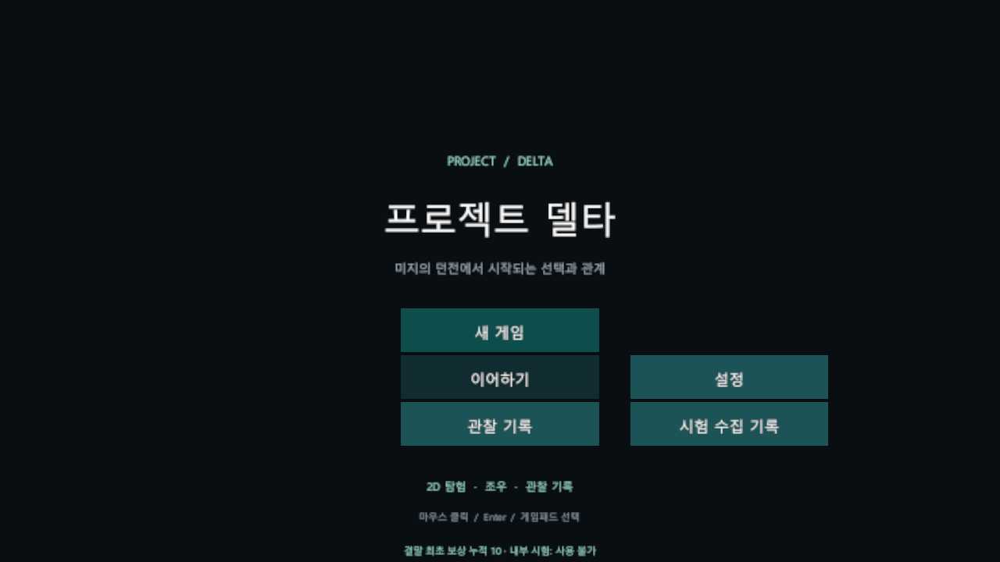
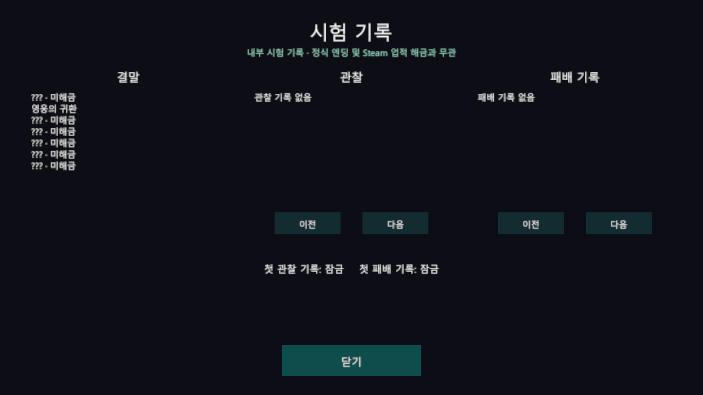
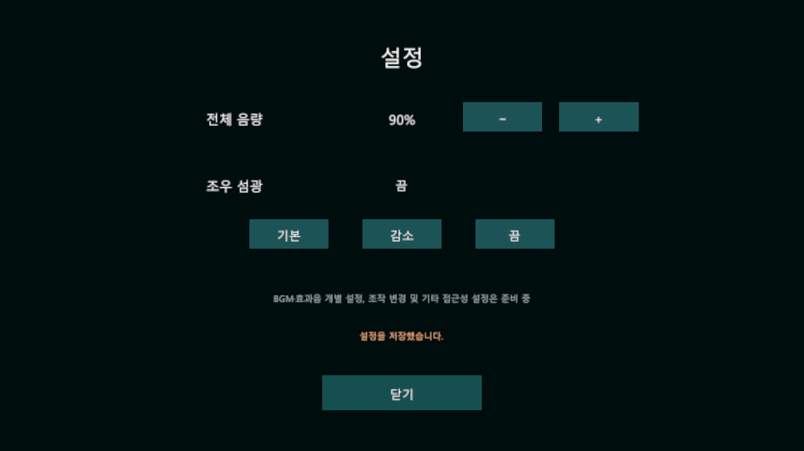
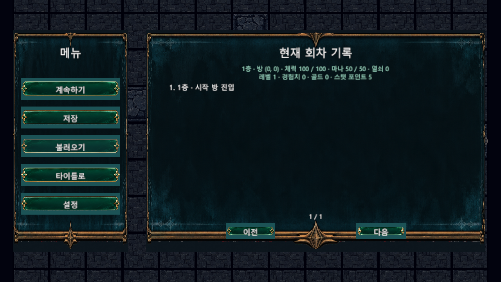

---
# 프로젝트 델타

2D 탑뷰 격자 탐험과 별도 턴제 전투, 선택·관계 중심 로그라이트 프로젝트.

기존 기획의 기능과 규칙을 기준으로 코드를 새로 작성한다. 현재는 기본 실행 흐름, 2D 격자 이동, 무작위 던전, 5층까지의 이동, 미니맵, 자동 조우, 기본 공격·방어·도주 전투, 10칸 인벤토리와 시험용 잠긴 문을 제공한다. 몬스터는 일본 애니메이션풍 성인 몬무스 디자인을 기준으로 제작하며, 첫 슬라임과 시험 고블린 조우에 시안 이미지를 표시한다.

---
## 현재 플레이 화면

타이틀의 결말 파편 누적 표시:

내부 시험 수집 기록 화면:

전체 음량과 조우 섬광 설정 화면:

---
## 개발 환경

- Unity 6000.3.21f1
- URP 2D, Unity Input System, uGUI
- Windows 64비트

---
## 실행

Unity Hub에서 저장소 폴더를 프로젝트로 추가하고 `Assets/ProjectDelta/Scenes/BootstrapScene.unity`를 열어 Play를 실행한다.

타이틀에서 새 게임을 선택하면 던전에 진입하고, 관찰 기록을 선택하면 저장된 시험 대상의 정보를 확인할 수 있다. 던전에서 WASD·방향키·게임패드 방향 입력을 새로 누를 때마다 한 칸씩 이동한다. 같은 키를 계속 누르고 있어도 자동으로 반복 이동하지 않는다. Esc 또는 게임패드의 취소 버튼으로 일시정지 메뉴를 열고 닫는다. 메뉴에서 계속하기·저장·불러오기·타이틀 복귀를 선택하며 오른쪽에 현재 회차 상태와 탐험 기록을 표시한다. 타이틀 복귀는 자동 저장이 성공한 뒤 진행된다. SD 주인공은 이동 방향에 따라 네 방향 이미지로 바뀌고 아래의 흰 화살표는 바라보는 방향, 돌무더기는 장애물, 갈색 문은 출구다. 타일과 플레이어는 기존보다 가로·세로 두 배 크기이며, 검은 테두리로 각 칸을 구분한다. 카메라는 방의 범위를 고려해 플레이어를 따라간다. 방을 이동할 때 화면이 부드럽게 전환된다. 오른쪽 최근 기록에는 방 진입, 문 상호작용과 성공한 회복약 획득·사용이 최대 네 개까지 표시된다. 전체 탐험 기록은 현재 회차 동안 보관되며 새 게임에서 초기화된다. H 키 또는 게임패드 왼쪽 스틱 버튼으로 전체 기록을 열고 페이지를 이동할 수 있다. 미니맵은 현재 방을 중심으로 주변 5×5 범위의 발견한 방과 연결을 표시한다. 직접 방문한 계단 방에는 파란 표시, 5층 마왕 방에는 붉은 표시가 나타난다. M 키 또는 게임패드 보기 버튼으로 발견한 방의 전체 지도를 열고 같은 버튼, Esc 또는 패드 B로 닫을 수 있다. 전체 지도에서는 방향키·게임패드 방향 버튼으로 이동하고, +/− 키·게임패드 어깨 버튼으로 배율을 조절하며 Home·게임패드 X로 현재 방에 돌아갈 수 있다. 지도 화면의 버튼도 마우스로 조작할 수 있다. 탐험 화면에서 미니맵을 클릭해 전체 지도를 열고 지도 화면의 버튼으로 닫을 수 있다. 문 앞에서 문 방향으로 마지막 이동을 마친 뒤 E 또는 게임패드의 남쪽 버튼을 누르면 다른 방으로 이동한다. 도착 직후 돌아가려면 방 안쪽으로 한 칸 이동한 뒤 문 쪽으로 돌아와 상호작용한다. 1~4층 계단 방 중앙의 파란 화살표에 서서 E 또는 게임패드 남쪽 버튼을 누르면 다음 층으로 이동하고 자동 저장한다. 일반적인 저장 실패 시 기존 층과 위치를 유지한다. 파일 교체 후 최종 재읽기가 실패하는 경우에는 디스크와 현재 위치가 달라질 수 있으며 기존 파일은 백업에 보존된다. 5층 마왕 방 입구에서는 체력·마나·장비·유물·소지품을 확인하고 준비를 계속하거나 마왕전에 진입한다. 새 회차의 시작 방과 처음 연결된 일반 방에 들어가면 슬라임 한 개체와 조우한다. 적을 만나면 출현 연출이 표시되고 전투 화면으로 자동 전환된다. 연출 중 이동과 전투 입력은 잠긴다. 이전 조우 선택 화면의 관찰·회유 기능은 자동 진입 흐름에서는 사용할 수 없으며, 일반 전투 내 관찰·회유 연결은 후속 작업이다. 이미 기록한 관찰 정보는 타이틀의 관찰 기록에서 확인할 수 있다. 전투는 라운드 시작 시 속도가 높은 순서로 행동하며 동속도에서는 플레이어가 먼저 행동한다. 라운드 중 속도 변화는 다음 라운드에 반영한다. 기본 공격·방어·회복약과 시험 기술 강한 일격을 사용하면 적도 자신의 순서에 기본 공격으로 대응한다. 강한 일격은 마나 10, 공격 보정 +10, 치명타 확률 40%, 맨손 배율 1.5배와 자기 차례 기준 대기 1턴의 시험값을 사용한다. 마나 부족이나 대기 중 사용 시 행동과 마나는 소모되지 않는다. 시험 회복약은 실제 회복에 성공할 때 한 개와 행동을 소비한다. 기본 명중률은 90%에 명중 보정과 상대 회피의 절반을 반영해 5~95%로 제한하며, 기본 피해는 공격력에서 적용 방어력을 빼고 최소 1을 적용한다. 방어는 행동을 소모해 다음 자신의 차례까지 적용 방어력에 10을 더한다. 일반 전투 후퇴는 플레이어와 가장 빠른 생존 적의 속도에 각각 1~20 주사위를 더해 비교하며 동점은 실패한다. 성공하면 보상 없이 같은 층의 이전 방으로 돌아가고, 단일 또는 시험 다수 적의 개별 체력과 미완료 상태가 유지된다. 실패하면 행동을 소모해 적의 차례가 진행된다. 승리하면 해당 조우가 완료되고 기존 방으로 복귀한다. 패배하면 타이틀로 돌아간다. 전투 후 체력은 유지되며 층 이동에 성공하면 회복된다. 탐험 중 I 또는 게임패드 북쪽 버튼으로 인벤토리를 열고 닫는다. 슬롯을 선택한 뒤 다른 슬롯을 선택하거나 마우스로 끌어 놓아 아이템을 이동·교환할 수 있다. 선택 중 취소하면 이동을 중단한다. 시험 아이템을 받을 공간이 없으면 새 아이템을 두고 가거나 기존 묶음을 선택해 확인 후 교체할 수 있다. 시험 소형·대형 회복약은 체력을 각각 최대 25·60, 마나 회복약은 마나를 최대 30 회복한다. 탐험이나 전투에서 선택해 사용하며 효과가 없으면 소비되지 않는다. 선택한 아이템 묶음은 이름과 전체 수량을 확인한 뒤 버릴 수 있고 기본 선택은 아니요다. 보라색으로 표시된 문은 시험용 잠긴 문이며, 인벤토리에서 지급한 시험 열쇠 하나를 사용해 양방향으로 열 수 있다. 잠긴 문 앞에서 F 또는 게임패드 서쪽 버튼으로 공격력 판정을 통한 강제 개방을 한 번 시도할 수도 있다. 실패 후에도 열쇠로 열 수 있다. 현재 판정의 공격력 50과 문 난이도 50은 시험값이다.

오른쪽 위 미니맵은 현재 방과 방향을 초록색으로, 방문한 방을 밝은색으로 표시한다. 연결만 확인한 미방문 방은 어두운 윤곽으로 나타나며, 아직 확인하지 못한 방과 비밀 통로는 숨긴다. 새 게임을 시작하면 방문 기록이 초기화된다.

새 게임마다 일반 방 8~10개와 시작 방·계단 방·상위 개체 방, 시험 비밀방 한 곳이 연결된 1층 구조를 생성한다. 2~4층도 임시로 같은 생성 규칙을 사용하며 이전 층으로 돌아갈 수 없다. 5층은 계단과 상위 개체 방 대신 마왕 방이 배치된다. 층 이동 시 기존 시험 규칙에 따라 체력만 회복되며 마나는 유지된다. 정식 층별 몬스터와 전투 기술·보상은 후속 작업이다. 주인공과 슬라임 퀸 이미지는 개발용 시안이며 시험 적의 능력치는 임시값이다. 인벤토리의 시험 아이템·열쇠 지급은 개발 확인용 기능이다. 잠긴 문은 필수 경로가 아닌 일반 말단 방에 하나만 배치되며 해당 방이 없으면 배치하지 않는다. 정식 열쇠 획득과 정식 아이템 목록·드롭 확률은 후속 작업이다.

인벤토리에서 시험 장비를 지급하고 선택한 뒤 장착할 수 있다. 무기·방어구·장신구·가방은 각각 한 개를 장착하며 이전 장비는 인벤토리로 돌아간다. 시험 검은 공격력 +5와 치명타 40%·1.5배, 도끼는 공격력 +10과 치명타 30%·2배, 경갑은 방어력 +8·속도 +2, 전투 장신구는 공격력 +3·방어력 +2, 낡은 주머니는 인벤토리 +2칸을 적용한다. 전투 기본 공격은 장착 무기의 치명타를 사용하며 강한 일격의 치명타 확률은 기술의 시험값을 유지하고 무기 배율을 사용한다. 장비 변경은 회차 저장에 성공한 뒤 적용되며 기존 다른 회차의 저장이 있으면 덮어쓰지 않는다. 가방 교체나 해제로 보관 공간이 부족하면 기존 장비와 아이템이 유지된다. 장비 획득 경로·무작위 옵션·저주는 후속 작업이다.

장비는 개별 인스턴스에 등급·추가 옵션·저주를 보관한다. 일반·고급은 옵션 1개, 희귀·전설은 2개이며 추가 옵션과 저주 효과는 획득 전에 공개된다. 시험 보상은 소비품이 없는 경우 10%로 기본 검을 내고, 등급은 네 종류를 균등하게 선택하며 20%로 저주를 적용한다. 공격·방어·속도 중 중복 없이 고르는 옵션 +2와 저주의 속도 −2, 확률과 정화 결과는 정식 밸런스가 아닌 시험값이다. 정해진 후보는 보상 화면 전에 저장되어 재시작해도 재추첨되지 않는다. 인벤토리의 시험 정화는 결과가 지정된 저주만 확인 후 제거하며, 정식 정화 비용과 연구가·이벤트 연결은 후속 작업이다.

전투 화면의 위쪽에는 적 초상화와 개별 체력·대상 선택, 상단에는 라운드와 유물 준비 상태를 표시한다. 아래쪽에는 플레이어 체력·마나와 행동 버튼을 배치한다. 전투 유혹은 시험 이벤트 전투로 이어지며, 전투 회유·일반 전투 관찰은 준비 중이다. 상단의 유물 수와 효과는 현재 회차의 실제 보유 상태다.

전투에서 항복을 선택하면 확인 화면이 열리고 기본 선택은 아니요다. 취소하면 행동을 소모하지 않는다. 패배와 항복은 확인된 상대와 원인을 별도의 영구 기록에 저장한 후 해당 회차를 종료한다. 기록 또는 종료에 실패하면 현재 전투에서 다시 시도할 수 있으며 기존 파일을 보존한다. 기록 후 종료 중단이 발생한 경우 다음 실행에서 종료를 복구한다. 다른 회차의 저장은 보존한다. 마왕과 별도 이벤트 전투의 결과 처리는 후속 작업이다.

실제 조우에서 승리하면 저장된 보상 후보를 확인한다. 일반 적의 개체당 경험치는 1층부터 60·80·100·120·140이며 상위 시험 상대는 해당 층의 3배다. 다수 적의 경험치는 이번 전투에 참가한 개체별로 합산한다. 골드는 일반 적당 10, 상위 개체당 30의 시험값이다. 소비 아이템 확률은 일반 적당 30%, 상위 개체 70%를 사용하며 시험 후보는 소형·대형 체력 회복약과 마나 회복약 중 추첨하며, 종류와 수량은 보상 후보에 저장된다. 각 종류의 묶음 한도는 시험값 5개다. 인벤토리가 가득 차면 포기하거나 기존 묶음을 선택해 확인 후 교체할 수 있다. 경험치로 레벨이 오르면 기획서의 포인트를 지급하며 최대 레벨은 10이다. 보상 후보를 화면 표시 전에 저장하고 획득·포기와 조우 완료를 함께 저장하므로 중단 후 같은 후보를 확인할 수 있다. 다른 회차의 저장이 있으면 교체를 명시적으로 선택해야 한다. 정식 골드량과 장비·유물 보상은 후속 작업이다.

일반 전투의 유혹 버튼은 생존 적을 별도 시험 이벤트 전투로 전환한다. 상대별 체력과 진행 게이지를 보고 관찰 또는 세 가지 시험 행동을 선택한다. 첫 행동은 플레이어가 맡으며 이후 양측 시험 매력과 주사위를 비교해 주도권을 정하고 동점은 기존 주도권을 유지한다. 모든 대상이 제거되면 승리하며 이벤트 전투에 들어온 생존 대상은 기본 경험치의 80%, 그 전에 일반 전투에서 처치한 대상은 100%를 지급한다. 시험 정력 0은 패배로 기록한다. 완료한 행동은 각각 저장되며 재시작하면 마지막 저장 상태부터 이어간다. 명시적인 시험 전투 중단은 보상을 포기하고 이전 방으로 돌아간다. 시험 정력 100, 매력 50, 행동 비용과 진행량은 미확정 수치다. 관찰은 현재 대상 정보를 보여주며 영구 관찰 도감과는 아직 연결되지 않는다. 정식 상성·후퇴 판정·아이템 보상과 미믹 상자 전투 연결은 후속 작업이다. 시험 전투는 최대 256개 행동을 기록하며 한도에 도달하면 시험 전투를 중단할 수 있다.

일부 일반 방에는 시험 떠돌이 상인이 있다. 상인 곁에서 E 또는 게임패드 남쪽 버튼을 누르면 대화·상점·떠나기를 선택할 수 있다. 상점은 기존 층별 시험 상품과 가격·재고를 사용하며, 대화로 돌아온 뒤 같은 층에서 다시 방문하거나 저장 후 재개해도 거래 상태가 유지된다. 다음 층에 상인이 배치되면 해당 층의 별도 상점을 이용한다. 상인 역할·대사와 배치는 시험값이며, 상인의 상점에서는 개발용 무료 유물 지급을 제공하지 않는다.

시험 상인 대화에는 영구 호감도와 현재 관계 단계가 표시된다. 시험 우호 선택은 한 회차에 한 번 호감도 5를 올리며 실제 증가량을 안내한다. 호감도는 NPC별로 0~100이며 회차 종료와 재시작 이후에도 유지된다. 단계는 0~33 중립, 34~66 관심, 67~84 신뢰, 85~99 특별, 100 엔딩 가능이다. 실제 엔딩과 추가 선행 조건은 후속 작업이다. 현재 우호 선택의 수치와 회차 제한은 시험값이다. 관계 저장이 손상되거나 다른 실행에서 변경되면 기존 파일을 보존하고 관계 변경을 차단한다.

일반 방의 시험 이벤트는 방 진입 후 자동으로 열린다. 조사에는 시험 골드 10이 필요하며 보유 골드가 부족하면 조사 선택지와 현재 조건을 표시한다. 조사 판정은 장비를 제외한 공격력 50과 시험 난이도 50을 사용하고 두 주사위가 동점이면 성공한다. 성공 시 시험 골드 20을 얻으며 떠나기를 선택해도 결과를 확인한다. 선택 순서와 주사위·결과·골드는 표시 전에 저장되어 재시작해도 유지되고 같은 이벤트는 회차당 다시 발생하지 않는다. 이벤트 소재·비용·보상과 배치는 시험값이며 정식 이벤트 확장은 후속 작업이다.

일반 층의 상자에 가까이 가서 E 또는 게임패드 남쪽 버튼을 누르면 상자 화면이 열린다. 잠긴 상자는 열쇠를 사용하거나 강제 개방을 한 번 시도할 수 있으며 실패해도 열쇠를 사용할 수 있다. 상자를 열면 고정된 보상 또는 미믹 전투가 결정되고 저장된다. 미믹에게서 후퇴하면 남은 체력과 보상 후보가 유지된다. 승리 후 상자를 다시 확인해 선택한 아이템을 획득하거나 포기하며 경험치를 받는다. 가방이 가득 차면 선택한 기존 묶음을 확인 후 교체할 수 있다. 함정은 방에 처음 들어갈 때 한 번 판정하며 결과를 저장한다. 층당 상자 2~3개와 함정 1개, 상자 등급·잠금 배치, 회피·피해 수치와 회복약 보상은 시험값이다.

인벤토리의 시험 상점·유물 버튼으로 경제 화면을 연다. 최초 방문한 층의 상품 가격과 재고는 저장되며 같은 층 재방문과 재시작에서 유지된다. 상품을 선택해 구매하고 같은 상품의 보유 아이템을 선택해 판매할 수 있다. 판매가는 해당 상품 구매가의 절반을 시험상 버리며 판매해도 상점 재고는 늘지 않는다. 상품 가격을 확인할 수 없는 개별 옵션 장비의 판매는 지원하지 않는다. 구매·판매는 골드와 인벤토리, 재고를 함께 저장하며 실패 시 기존 상태를 보존한다. 현재 상품·재고 구성은 시험값이며 정식 상점 방과 NPC는 후속 작업이다.

시험 유물은 일반 가방과 별도로 최대 5개를 보유하며 중복 획득할 수 없다. 획득 즉시 표시된 시험 공격·방어·속도 효과가 전투에 적용된다. 보유 한도가 가득 차면 기존 유물과 새 유물을 확인하고 명시적으로 교체하거나 취소한다. 시험 화면의 유물 버튼은 개발 확인용 무료 지급이며, 정식 획득 경로와 효과 수치는 후속 기획이다.

탐험 중 K 또는 게임패드 오른쪽 스틱 버튼으로 저장할 수 있으며 Esc 메뉴에서 저장과 불러오기를 선택할 수 있다. 타이틀의 이어하기로도 재개한다. 저장에는 현재 층·생성 시드·방과 플레이어 위치·체력·마나·소지품·시험 열쇠·방문 기록·시험 문과 조우 상태·회차 기록이 포함된다. 이동이나 방 전환 중에는 저장할 수 없다. 관찰 기록과 회차 저장은 별도 파일이며 손상되거나 다른 실행에서 변경된 회차 파일은 자동으로 덮어쓰지 않는다. 현재 회차 파일이 손상되거나 누락되면 유효한 백업 또는 임시 기록을 읽고 복구 상태를 안내한다. 이때 원본과 복구 파일을 보존하며 추가 저장을 차단한다. 새 회차 저장에는 던전 생성 버전·구조 지문·비밀 통로 상태가 포함되어 재생성된 구조가 다르면 이어하기를 차단한다. 발견한 비밀벽을 바라보고 E 또는 게임패드 A를 누르면 개방하고 다시 누르면 들어간다. 발견 전에는 벽 앞의 희미한 흔적을 조사해 비밀벽을 찾아야 하며, 발견한 비밀방은 미방문 지도 칸으로 공개된다. 비밀방 한 곳과 발견 방식은 시험용이며 정식 발생 수량과 확률은 미확정이다. 던전 생성은 버전별 구조와 필수 경로를 검사하며 1,002개 시드로 재현성과 연결을 검증했다. 시험 탐험의 방 이동·지도·비밀벽·저장과 새 실행 이어하기를 하나의 플레이 흐름으로 검증했다. 1·2층 몬스터 정의와 방별 최대 3개체 조우의 데이터 규칙은 준비되었다. 새 회차의 첫 슬라임 조우를 해결하면 1층의 일반 방 한 곳에서 고블린 두 개체의 시험 조우가 발생한다. 이전 저장에 있던 슬라임 다수 조우는 기존 종족을 유지한다. 전투에서 생존 대상을 직접 선택하며, 쓰러진 대상을 대신할 다른 적은 직접 다시 선택한다. 정식 일반 몬스터의 발생 확률과 나머지 대상 배치는 후속 작업이다. 슬라임과 고블린의 전투·관찰 수치는 공통 시험값이며 고블린의 종별 능력과 행동 예고는 후속 작업이다. 강한 일격에 시험 치명타 판정을 적용한다. 기본 공격의 무기별 치명타와 독·출혈의 실제 전투 적용은 후속 작업이다. 이전 버전 1 저장은 현재 생성 기준으로 읽지만 당시 구조와 일치하는지는 확인할 수 없다. 파일을 직접 복원하는 관리 기능은 후속 작업이다.

타이틀의 시험 수집 기록에서 현재 지원하는 일곱 시험 결말과 실제 관찰·패배 기록을 확인한다. 미해금 결말의 이름과 조건은 숨기며, 기록이 손상되거나 실행 중 기존 파일이 사라지면 확인 불가로 표시한다. 이 화면은 내부 시험 기록이며 정식 엔딩과 Steam 업적을 해금하지 않는다. 공식 업적 수와 관련 조건은 기획서의 수치가 일치하지 않아 아직 확정하지 않았다.

타이틀과 일시정지 메뉴에서 전체 음량과 조우 섬광을 설정한다. 전체 음량은 0~100%, 조우 섬광은 기본·감소·끔을 선택하며 변경 성공 시 별도 파일에 저장하고 다음 실행에 적용한다. 설정 파일이 손상되면 원본을 보존하고 기본 또는 복구값임을 안내한다. BGM·효과음 개별 음량, 키 재설정, 나머지 접근성 설정은 아직 구현되지 않았다.

타이틀은 영구 결말 기록의 최초 해금 파편 누적 획득량을 표시한다. 내부 시험에서는 파편을 사용할 수 없다. 기록이 손상되거나 복구 대기일 때는 획득량을 추정하지 않고 확인 불가로 표시한다. 영구 성장 구매·새 회차 적용과 난이도별 파편은 아직 구현되지 않았다.

마왕전에는 이전 프로젝트의 시험 능력치를 사용하며 체력에 따른 세 단계를 표시한다. 마왕전 도주는 불가능하고 항복은 별도 확인한다. 일반 승리는 경험치를 지급하지 않는다. 승리 후 현실 귀환 또는 던전 잔류를 선택하고 확인 가능한 결말 후보 중 하나를 직접 선택한다. 패배와 항복은 마왕의 종으로 이어지며 마왕 패배 기록도 남긴다. 최초 결말 해금 파편은 결말별로 한 번만 지급하고 선택·영구 기록·결말 확인을 저장해 중단 후 재개할 수 있다. 정력·관계·도감·전층 탐색·저주 합산에 따른 결말 조건과 난이도별 회차 완료 파편, 마왕 이벤트 전투 및 전투 중 재개는 아직 구현되지 않았다.

---
## 코드 구성

| 폴더 | 역할 |
|---|---|
| Assets/ProjectDelta/Core | Unity 객체에 의존하지 않는 게임 상태 규칙 |
| Assets/ProjectDelta/Runtime | 초기화·씬 전환·입력·화면 표시 |
| Assets/ProjectDelta/Editor | 기본 씬 생성·Windows 빌드 |
| Assets/ProjectDelta/Tests | EditMode·PlayMode 검증 |
| docs/development | 일차별 작업과 확인 결과 |

---
## 검증과 빌드

PowerShell에서 `Tools/Run-DayFortyTwoChecks.ps1 -Check EditMode`, `-Check PlayMode`, `-Check Build`로 실행한다. 편집기 경로가 다르면 `-UnityPath`로 지정한다. 플레이 화면을 창을 띄우지 않고 캡처하려면 `-Check Screenshot`을 사용한다. Windows 테스트 실행 파일 검증은 `-Check PlayerTests`를 사용한다. 원본 프로젝트가 Unity에서 열려 있으면 별도 프로젝트 복사본에서 테스트한다.

기본 씬 재생성은 Unity 메뉴 `Project Delta/1일차/기본 씬 재생성`으로 실행한다. 생성기는 해당 기본 씬 세 개를 덮어쓰므로 씬 편집 후에는 변경을 먼저 보존한다.

기존 던전에 이동 요소를 다시 연결하는 메뉴는 `Project Delta/2일차/던전 이동 구성`이다. 바닥이 완전히 비어 있을 때만 시험 바닥·장애물을 생성하며, 기존 바닥의 빈 칸과 사용자 장애물은 보존한다. 이전 시험 장애물과 정확히 일치하는 배치는 밝은 전용 타일로 교체한다. 다른 열린 씬의 미저장 변경은 저장 또는 취소를 확인한다.

두 시험 방을 연결하는 메뉴는 `Project Delta/3일차/시험 방 연결`이다. 기존 객체나 문 위치의 타일과 충돌하면 구성을 중단한다. 다른 열린 씬의 미저장 변경은 저장 또는 취소를 확인한다.

세 번째 방과 지도를 구성하는 메뉴는 `Project Delta/4일차/시험 방과 지도 구성`이다. 기존 방·문 설정이 시험 구성과 다르거나 새 출구 칸이 점유되어 있으면 구성을 중단한다.

검증 기록은 `Artifacts`, 42일차 Windows 빌드는 `Builds/Day42`에 생성되며 Git에서 제외한다. 기존 빌드도 각 일차의 경로에 남는다.
